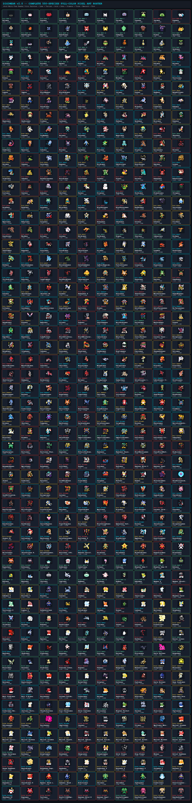

# DigiWear 📟⌚
### The authentic 90s Virtual Pet experience, rebuilt for your smartwatch & phone.

[](https://developer.android.com/wear)
[](RELEASE_NOTES_v2.6.md)
[](https://kotlinlang.org)
[](https://developer.android.com/jetpack/compose)
[](https://github.com)
[](https://humulos.com/digimon/)
[](LICENSE)

---

## 👋 Hey Tamers! Welcome to DigiWear

If you grew up carrying a keychain virtual pet, shaking a Pendulum on the playground, or obsessing over evolutionary branches on File Island, **DigiWear** was built for you.

DigiWear brings the full 1997 classic virtual pet experience to modern smartwatches and phones with zero compromises. It runs **completely standalone** on your smartwatch—meaning you can leave your phone at home, go about your day, and raise your partner right on your wrist. When you want to dig deeper, the Android companion app gives you a dedicated hub for cryo-storage, DNA Jogress fusions, barcode wild encounters, online battles, and custom campaigns.

### 🌟 What makes DigiWear special:
- ⌚ **100% Standalone on Your Wrist**: Your partner lives directly on your watch. Hunger, strength, sleep, and battles calculate in real time even when disconnected from your phone.
- 🔋 **All-Day Battery Life**: Smart 60s sensor batching, off-body sleep detection, zero-allocation 12fps watch face rendering, and ultra-low-power ambient wireframes (≤ 6% OPR) keep your battery running strong all day long.
- 🔘 **Real Physical & Molded Button Support**: Got physical buttons or a rotating crown? Use them just like the original `[A]`, `[B]`, and `[C]` buttons. Prefer touch? Disable the button rail to enjoy an evenly balanced 10-button perimeter frame with expanded pet roaming room.
- 🥚 **550 Authentic Monsters & 16 Starter Eggs**: Complete roster from Baby I to Super Ultimate with canonical multi-tone pixel sprites and distinct 12-frame procedural animation matrices for every species.
- 🧬 **85 DNA Jogress & DigiXros Fusions**: Instant O(1) indexed recipe lookup on your watch or in the companion app's dedicated Fusion Lab.
- 🥊 **Battle Anyone, Anywhere**: Fight via NFC Tap-to-Duel, scan real barcodes with your phone camera for wild battles, or connect to **Digimon 0nl1ne / D-Com / A-Com / WiFiCom** using standard 128-bit CommCodes.
- 🚶 **Step-Powered Adventure Sagas**: 114 sectors across 5 storyline sagas where your real-world walking steps unlock bosses, rare eggs, and crests.
- 📱 **Direct Wireless Sideloading**: Update your watch app straight from the phone companion app over Wi-Fi—no PC or terminal needed!

---

## 🧬 Evolution & DNA Jogress Guide (All 550 Species)

Every single one of the **550 Digimon** in DigiWear is naturally reachable from the **16 Starter Digi-Eggs** via canonical Bandai 1997 V-Pet, Digimon Pendulum, and Digimon Color evolution rules, or via **85 DNA Jogress / DigiXros / Mode Change** combinations.

👉 **[Check out the complete Evolution Guide & Interactive Tables (`DIGIVOLUTION_GUIDE.md`)](DIGIVOLUTION_GUIDE.md)**

### Visual Evolution & DNA Jogress Chart


### Master 550-Species Full-Color Pixel-Art Sprite Sheet


---

## ⌚ Watch Compatibility: Wear OS & Full Android Standard Watches

DigiWear is built to run smoothly on both Google **Wear OS** smartwatches and standalone **AOSP / Full Android Watches (FAWs)**:

| Feature | Wear OS 3.0 / 4.0 / 5.0+ | Standalone AOSP / Full Android Watches |
| :--- | :--- | :--- |
| **Supported Devices** | Pixel Watch 1/2/3, Galaxy Watch 4/5/6/7/Ultra, TicWatch, OnePlus Watch 2 | Kospet, Lokmat, Lemfo, Zeblaze, Rogbid, and generic round/square Android watches |
| **Release APK** | `DigiWear-WearOS-release.apk` | `digiwear-aosp-standard-watch-release.apk` (or `DigiWear-WearOS-release.apk`) |
| **Google Play Services** | Supported (Uses Wearable Data Layer) | **Not needed!** Connects via direct Wi-Fi / Hotspot LAN Bridge (TCP 45820 / UDP 45821) |
| **Step Tracking** | Hardware Step Counter & Step Detector | Hardware sensors with automatic wrist accelerometer fallback |
| **Display Support** | Round OLED safe padding + Ambient OPR ≤ 6% | Square, Rectangular, and Round screens with **Display Shape Override (`AUTO` / `ROUND` / `SQUARE`)** |
| **Physical Buttons** | Stem buttons, volume keys, and rotating crown | Physical keys (`VOLUME_UP` = `[A]`, `ENTER` = `[B]`, `BACK` = `[C]`) and swipe-to-back |

### 📶 AOSP Smartwatch Wi-Fi & Hotspot LAN Bridge
Got a watch without Google Play Services? No problem:
1. Connect your smartwatch and phone to the same Wi-Fi network (or turn on your phone's Wi-Fi Hotspot and connect your watch to it).
2. On your watch, open DigiWear → **Settings** → **AOSP LAN BRIDGE** to see the watch's IP and port (e.g. `192.168.43.112:45820`).
3. On your phone, open the companion app → **Settings** → **AOSP LAN BRIDGE** and tap **`🔍 LINK AOSP`**.
4. The companion app finds your watch automatically and links up. You can sync live stats, send care commands, beam custom campaigns, and perform 1-tap fusions right over local Wi-Fi.

### ⭕ Round Screen Fit for AOSP Watches
Some round Android watches run phone ROMs that mistakenly report square screens. In DigiWear's Settings, simply toggle **Display Shape Override** to `ROUND` to pull all content safely within the circular bezel.

---

## 🎮 How DigiWear Works

### 1. Authentic V-Pet Lifecycle Simulation
Care timing follows the original Bandai schedules based on real elapsed time:

```
Elapsed Time = Current UTC Time - Last Saved Time
```

| Life Stage | Hunger Loss | Strength Loss | Poop Interval | Sleep Schedule | Care Mistake Grace Period |
|---|---|---|---|---|---|
| **Baby I** | Every 3 min | Every 3 min | Every 15 min | Always awake | No care mistakes |
| **Baby II** | Every 10 min | Every 10 min | Every 30 min | 20:00 – 07:00 | 10 min after call |
| **Child** | Every 30 min | Every 30 min | Every 60 min | 21:00 – 08:00 | 10 min after call |
| **Adult** | Every 45 min | Every 45 min | Every 90 min | 22:00 – 08:00 | 15 min after call |
| **Perfect** | Every 60 min | Every 60 min | Every 120 min | 23:00 – 09:00 | 15 min after call |
| **Ultimate** | Every 90 min | Every 90 min | Every 180 min | 23:00 – 09:00 | 15 min after call |

- **Sleep Preservation**: Tuck your partner in and turn off the lights during their sleep window to freeze hunger and strength decay until morning.
- **Care Mistakes**: Counted only if you ignore a hunger/strength call or forget to turn off sleep lights past the grace window.
- **Overfeeding**: Feed up to 5 extra meat past full satiety to build weight and meet specific evolution branch criteria without making your partner sick.
- **16 Starter Digi-Eggs**: Choose your starting egg freely upon fresh start or rebirth: Botamon, Punimon, Poyomon, Yuramon, Zurumon, Mokumon, Kuramon, Nyokimon, Pichimon, Pukamon, Cotsucomon, Fufumon, Algomon Baby I, Dokimon, Choromon, or Bubbmon Color.

---

### 2. Physical Button & Touch Controls

1. **Authentic 3-Button LCD Mode (Right / Left Button Rail)**:
   - Iconic 8-icon Bandai LCD border:
     - Top arc: `[📊 STATUS]`, `[🍖 FEED]`, `[🥊 TRAIN]`, `[⚔ BATTLE]`
     - Bottom arc: `[🧹 FLUSH]`, `[💡 LIGHT]`, `[💉 MEDS]`, `[🚨 ATTENTION]`
   - Dedicated molded on-screen touch rail: `[A]` (Select/Cycle), `[B]` (Confirm/Execute), and `[C]` (Cancel/Back).
   - Configurable wrist placement: Set button rail to `RIGHT` (left wrist) or `LEFT` (right wrist) with automatic utility chip balancing.
2. **Modern Touch Mode (Button Rail OFF)**:
   - When the button rail is disabled (`"OFF"`), the `[A]`, `[B]`, `[C]` rail buttons disappear and the two utility buttons split across the dial into **bilateral symmetry**:
     - `Quest / Adventure` anchors at **9 o'clock (West)**
     - `Settings` anchors at **3 o'clock (East)**
   - Combined with the 4 top and 4 bottom care icons, this forms an evenly balanced **10-button perimeter frame** hugging the outer bezel.
   - The pet's roaming boundary expands horizontally on both sides, providing maximum center display area for walking and idle animations.
3. **Physical Hardware Key Support**:
   - **Button A (Select / Cycle)**: Primary stem button, D-Pad Up, Volume Up, or clockwise crown turn.
   - **Button B (Confirm / QTE Strike)**: Secondary stem button, Enter key, D-Pad Center, or Spacebar.
   - **Button C (Cancel / Back / Light)**: Tertiary stem button, Back button, or Escape key.
4. **Dual Training Modes**:
   - **Classic QTE Bar**: Stop the oscillating power bar in the 80%–100% sweet spot to smash iron blocks and boost Effort and Strength.
   - **Authentic Pendulum Shake**: Powered by your watch's accelerometer. Shake your wrist 5–8 times during the 3-second countdown to trigger mega hits with authentic haptic tick feedback.
5. **Authentic 8-Bit Chiptune Buzzer**:
   - Classic 4-beep attention calls (`pip-pip-pip-pip`), button clicks, hit chirps, and 8-bit victory fanfares (muted by default for discreet wear, toggleable in Settings).

---

### 3. 4-Mode Battle System & 128-Bit CommCode

Every battle features animated face-to-face combat (`flipHorizontal` on the left fighter), projectile clashes (`●━━▶` / `⚡MEGA HIT⚡`), live HP bars, and a 500ms QTE reflex window for a +25% critical strike boost:

1. **🏟 Mode 1 — Adventure Colosseum**:
   - Step-powered quest sectors with environmental weather hazards (`Thunderstorm`, `Magma Heat`, `Tidal Current`, `Miasma Fog`, `Zero Gravity`, `Apocalymon Void`) and turn-by-turn boss combat.
2. **📡 Mode 2 — Wild NFC & Barcode Scanner**:
   - Tap any NFC tag/card or scan real retail UPC/EAN barcodes with your phone camera to spawn unique wild Digimon encounters, including an 18% rare boss spawn rate!
3. **📶 Mode 3 — NFC Tap-to-Duel P2P**:
   - Tap Watch-to-Watch, Watch-to-Phone, or Phone-to-Phone via NFC for instant local duels and DNA Jogress fusions.
4. **🌐 Mode 4 — A-Com / D-Com / WiFiCom Online**:
   - 100% compatible with the 128-bit Crockford Base32 CommCode standard (`DW2-...`) and original 16/26-char DigiROM protocols (`V1-XXXX-XXXX-XXXX`).
   - **Watch-to-Phone Relay**: Tap your watch to your phone (or tap `RELAY DIGIROM` on your watch) to bridge your partner straight into the Phone Companion App's online tamer lobby.

---

### 4. Step-Powered Adventure Engine (114 Sectors across 5 Sagas)

Turn your daily steps into adventure progression across 5 authentic sagas:
1. **The Original Odyssey** (30 Sectors • File Island to Spiral Mountain • Climax: ZeedMillenniummon)
2. **Project Ark: The X-Antibody Crisis** (25 Sectors • Versandi, Uluda & Skuld Terminals • Climax: Death-X-mon)
3. **Frontier of the Ancients** (20 Sectors • Spirits of the Ten Warriors • Climax: Omnimon Merciful Mode)
4. **Catastrophe of the Seven Sins** (21 Sectors • Dark Area Gates & Bancho Brigade • Climax: Ogudomon & DarknessBagramon)
5. **Ghost Crypt: Hologram GRB Wave** (18 Sectors • Hologram Ghosts & Quantum Void • Climax: Apex Siriusmon)

- **Switch Sagas Anytime**: Swap between sagas right on your wrist without losing your progress.
- **Hardware Step Accuracy**: Preserves your step baseline across app restarts and device reboots so every step counts.
- **Boss Rewards & Egg Unlocks**: Defeating apex bosses awards exclusive relics and permanently unlocks rare Starter Eggs like Mokumon, Pukamon, Cotsucomon, and Algomon Baby I.

---

### 5. Android Phone Companion App

The companion app gives you a clean 5-tab control center:
1. **V-PET Tab**: Live viewport of your active partner inside a retro 1997 brick shell with biological gauges and remote care buttons.
2. **VAULT Tab**: Cryo-storage to keep your favorite Digimon safe in stasis, plus a dedicated **Fusion Lab** listing all 85 Jogress recipes with O(1) indexed lookups and a Memorial Hall of Fame.
3. **BATTLE Tab**: NFC duels, UPC barcode wild scanning, online D-Com packet battles, and 100-floor Colosseum tower gauntlet.
4. **EXPEDITION Tab**: Master 550-species DigiDex with species unlock guides, Sprite Studio Matrix Editor for custom 16x16 pixel sprites, and 114-sector saga exploration maps.
5. **SETTINGS Tab**: Responsive 2-column theme picker and 6-shell selectors, watch hardware toggles (3-button mode, wrist placement, haptics, buzzer, contrast), smartwatch connection diagnostics, AOSP Wi-Fi bridge, and full JSON database backup/restore.
6. **Home Screen AppWidget**: Put your live partner right on your phone home screen with live hunger hearts (`♥♥♥♥`), strength stars (`★★★★`), quick-care buttons, and seamless Cryo-Vault fallback when disconnected from your watch.

---

## 🚀 Installation & Sideloading

### 📱 Option 1: Direct Phone-to-Watch Wireless Sideloading (Recommended — No PC Needed!)

The easiest way to install and update DigiWear on your watch:
1. Install **`DigiWear-Companion-release.apk`** on your Android phone.
2. Open the companion app and go to **Settings → Wireless ADB Watch Sideloader**.
3. Connect your watch and phone to the same Wi-Fi network (or your phone's Wi-Fi Hotspot).
4. On your watch, open **Developer Options** and enable **ADB Debugging** and **Wireless Debugging**.
5. In the companion app, tap **Auto-Detect** (or enter the watch's IP and port), then tap **Connect**.
6. When prompted on your watch, tap **Always Allow**.
7. Tap **Download Latest** (or pick an APK from your phone), then tap **⚡ Sideload DigiWear to Watch ⚡**.
8. The companion app installs the APK, grants step and sensor permissions, and launches the app on your wrist automatically!

---

### 💻 Option 2: One-Click Helper Scripts (PC / Mac)

If you have a computer with ADB set up, use the included helper scripts:
- **Windows**: Double-click `sideload.bat` (or run `.\sideload.ps1` in PowerShell).
- **macOS / Linux**: Run `./sideload.sh`.

The script automatically detects connected devices over USB or Wi-Fi and installs the latest APKs.

---

### 🛠 Option 3: Manual ADB Commands

```bash
# Connect to your watch over Wi-Fi
adb pair <WATCH_IP>:<PAIRING_PORT>
adb connect <WATCH_IP>:<CONNECT_PORT>

# Install the watch app
adb -s <WATCH_IP>:<CONNECT_PORT> install -r release_bin/DigiWear-WearOS-release.apk

# Install the companion app on your phone via USB
adb install -r release_bin/DigiWear-Companion-release.apk
```

---

## 📦 Release Binaries (`release_bin/`)

Pre-compiled, signed APKs are ready to install in the `release_bin/` directory and on [GitHub Releases](https://github.com/Dalinuxx/DigiWear/releases):

| File | Target Platform | Description |
|---|---|---|
| `DigiWear-WearOS-release.apk` | Wear OS 3.0+ | Official signed release for Galaxy Watch, Pixel Watch, TicWatch, etc. |
| `digiwear-aosp-standard-watch-release.apk` | Standalone AOSP | Official signed release for Kospet, Lemfo, Zeblaze, etc. |
| `DigiWear-Companion-release.apk` | Android 13+ Phone | Official signed companion app with Wireless Sideloading & DigiVault |
| `wear-os-app-debug.apk` | Development | Watch debug build with developer logging enabled |
| `phone-companion-app-debug.apk` | Development | Phone debug build with developer logging enabled |

---

## 🆕 What's New in v2.6.0

See the full [v2.6.0 Release Notes](RELEASE_NOTES_v2.6.md) for detailed benchmarks and technical breakdown:
* **Circular Bezel Safe-Zone Geometry**: List headers, complication controls, and action buttons inset safely inside round watch bezels (`horizPad = 14.dp`, `vertPad = 26.dp`) with zero edge clipping.
* **Bilateral Touch Symmetry**: Turning the button rail `OFF` repositions `Quest` to 9 o'clock and `Settings` to 3 o'clock, creating a balanced 10-button perimeter ring and expanding pet walking headroom.
* **O(1) Indexed Jogress & DigiDex Lookups**: Pre-indexed target species lookups eliminate list lag across all 85+ fusion recipes and 550 species.
* **12-Frame Procedural Animation Matrix**: Complete 12-frame procedural transforms across all 550 species ensuring every action (`IDLE_1/2`, `WALK_1/2`, `FEED_START`, `JOY_EAT`, `SLEEP_1/2`, `REFUSAL`, `ATTACK_CHARGE/RELEASE`, `INJURED`) is visually distinct.
* **Watch Face 12fps Loop Hardening**: 30-second TTL battery percentage caching and zero-allocation scratch rect re-use eliminate Binder IPC overhead and GC pauses.
* **Cryo-Vault Tile & Widget Fallbacks**: Phone widget and Wear OS tile gracefully fall back to Cryo-Vault stasis status when disconnected, preventing default Botamon resets.
* **Embedded Direct Sideloading**: Companion app includes built-in release APKs for 1-tap wireless watch flashing over Wi-Fi without a PC.
* **Dedicated Wear OS Adventure & Radar Tile**: Glanceable sector progression, distance remaining to apex bosses, and 1-tap battle launch right from the wrist carousel.
* **Calorie-Based Evolution Growth Acceleration**: Physical workouts convert active calories burned into real partner growth (+15m evolution progression per 50 kcal burned) with optional Health Connect sync.
* **In-App Visual Saga Creator & Architect**: Design custom adventure sagas, pick environmental hazards, select boss encounters from all 550 monsters, and beam them to your watch over Wi-Fi.
* **100% Hardware-Independent & Optional**: All fitness features, tiles, and Health Connect sync operate with seamless no-sensor fallbacks, ensuring complete playability on any watch model.

---

## 🧪 Building from Source

```bash
# Run the complete test suite
./gradlew test

# Build all release and debug APKs
./gradlew assembleRelease assembleDebug
```

---

## 🤝 Community & Contributing

Contributions, feedback, bug reports, and sprite suggestions are always welcome!
1. Fork the repository.
2. Create your branch: `git checkout -b feature/MyFeature`.
3. Test your changes: `./gradlew test`.
4. Commit & push: `git commit -m 'Add MyFeature'` and open a Pull Request.

---

## 📜 Disclaimer & Credits

- **Digimon** and all associated characters, names, and assets are trademarks of **Bandai**, **Toei Animation**, and **Akiyoshi Hongo**.
- This project is an open-source fan creation developed for non-commercial educational and preservation purposes.
- Huge thanks to the virtual pet and fan emulation communities:
  - **[Humulos (Digital Monster Reference Engine)](https://humulos.com/digimon/)** for comprehensive lifecycle parameters and evolution branch data.
  - **[The Spriters Resource](https://www.spriters-resource.com/lcd_handhelds/)** for LCD sprite archives.
  - **[GMMan / DigimonColorSpriteTool](https://github.com/GMMan/DigimonColorSpriteTool)** for color sprite extraction tools.
  - **[ultramcu / acom-digimon](https://github.com/ultramcu/acom-digimon)** & **Digimon 0nl1ne** for physical signal and Comm Code protocol research.

---

<p align="center">
  <b>Built with ❤️ for Virtual Pet Trainers Worldwide</b>
</p>
